<div align="center">

# Waydee

**Harita tabanlı sosyal ticaret platformu**

Satıcılar haritada mağazalarını konumlandırır, fotoğraflarına ürün etiketi ekleyerek dijital vitrin kurar.
Yapay zekâ ise ürün görselleri üretir ve markalara uygun influencer'ları bulup analiz eder.


[Ekranlar](#-ekranlar) · [Mimari](#-mimari) · [Yapay Zekâ](#-yapay-zekâ) · [Ödeme](#-ödeme-altyapısı) · [AWS](#-aws-altyapısı) · [Kurulum](#-yerel-kurulum) · [Ekip](#-ekip)

</div>

---

## 📌 İçindekiler

1. [Genel Bakış](#-genel-bakış)
2. [Ekranlar](#-ekranlar)
3. [Özellikler](#-özellikler)
4. [Mimari](#-mimari)
5. [Teknoloji Yığını](#-teknoloji-yığını)
6. [Yapay Zekâ](#-yapay-zekâ)
7. [Ödeme Altyapısı](#-ödeme-altyapısı)
8. [AWS Altyapısı ve Dağıtım](#-aws-altyapısı)
9. [Güvenlik](#-güvenlik)
10. [Ölçeklenebilirlik](#-ölçeklenebilirlik)
11. [Proje Yapısı](#-proje-yapısı)
12. [Yerel Kurulum](#-yerel-kurulum)
13. [Lisanslar](#-açık-kaynak-lisansları)
14. [Yol Haritası](#-yol-haritası)
15. [Ekip](#-ekip)

---

## 🧭 Genel Bakış

Waydee üç fikri tek üründe birleştirir:

| | |
|---|---|
| 🗺️ **Konum** | Her mağaza, dünya haritasında 100 metrelik bir dairedir. Kullanıcılar mağazaları kategoriye göre haritada keşfeder. |
| 🛍️ **Sosyal ticaret** | Satıcı, gönderisindeki ürünleri fotoğrafın üstünde etiketler. Ziyaretçi etikete tıklayıp doğrudan ürüne gider; her gösterim ve tıklama ölçülür. |
| ✨ **Yapay zekâ** | Ürün fotoğrafından mankenli çekim üreten **AI Stüdyo** ve markaya uygun içerik üreticilerini bulup analiz eden **Waydee Agent**. |

Platform 5 dilde (Türkçe, İngilizce, Almanca, İspanyolca ve sağdan sola Arapça) çalışır. Açık ve koyu tema desteklenir.

---

## 🖼️ Ekranlar

> Görüntüler, kurgusal demo hesaplarıyla yerel ortamda alınmıştır. Ürün fotoğrafları Unsplash lisanslıdır.
> Influencer Keşfi ekranlarındaki hesaplar ve rakamlar, Waydee Agent'ın gerçek bir aramasının sonucudur.

### 1. Karşılama sayfası


Ziyaretçinin ilk gördüğü ekran. Ürün etiketli fotoğraflar sayfada süzülür. Kullanıcı `waydee.com/<kullanıcı-adı>` adresini seçerek doğrudan kayda başlar. Sayfa 5 dilde sunulur ve arama motorları için sunucu tarafında site haritası üretilir.

### 2. Harita ve mağaza kartı
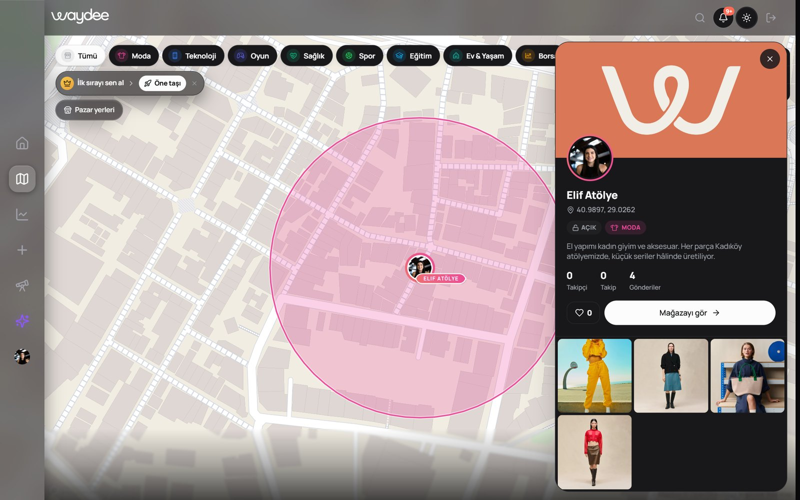

Platformun kalbi. Mapbox GL üzerinde her mağaza, sahibinin seçtiği renkte bir daire olarak görünür. Üstteki kategori çipleri (Moda, Teknoloji, Spor…) haritayı filtreler. Bir mağazaya tıklayınca sağda kart açılır: kategori, açıklama, takipçi ve gönderi sayısı, son gönderiler. Mağazanın yeri **PostGIS** ile doğrulanır: başka bir mağazayla çakışma kontrolü ve bölge fiyatlandırması veritabanında, coğrafi indeksle yapılır. Yeni mağazalar WebSocket üzerinden tüm açık haritalara anında düşer.

### 3. Mağaza profili
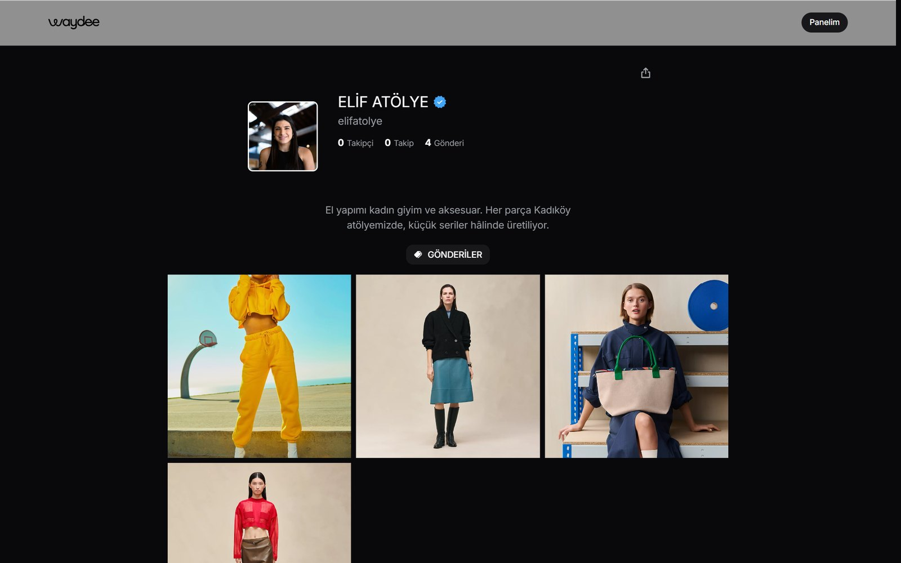

Her satıcının herkese açık vitrini (`waydee.com/elifatolye`). Profil fotoğrafı, doğrulama rozeti, açıklama ve gönderi ızgarası yer alır. Profil, bağlantı sayfası (link-in-bio) ve koleksiyon olarak da kullanılabilir.

### 4. Ürün etiketli gönderi
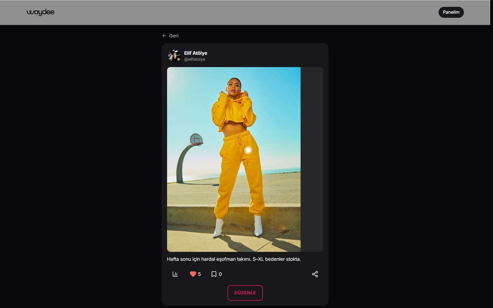

Fotoğrafın üzerindeki nokta bir **ürün etiketidir**: ürün adı, fiyatı ve satış bağlantısını taşır. Satıcı etiketleri elle yerleştirebilir ya da yapay zekâya önerdirebilir (bkz. [Yapay Zekâ](#-yapay-zekâ)). Her etiketin gösterim ve tıklama istatistiği satıcının analiz panelinde görünür.

### 5. AI Stüdyo
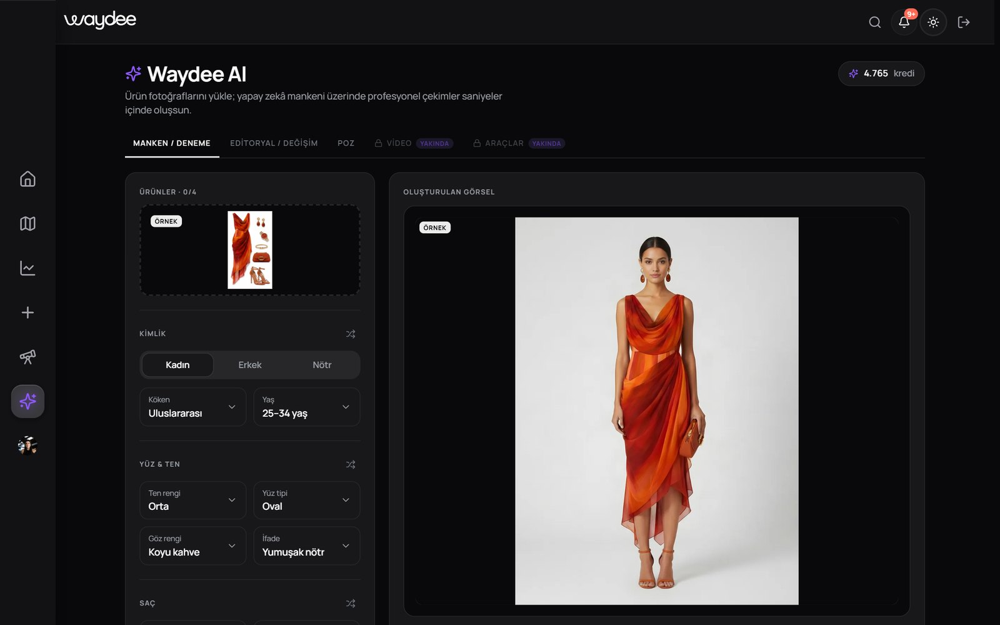

Satıcı ürün fotoğraflarını yükler ve manken özelliklerini (cinsiyet, köken, yaş, ten, yüz tipi, saç, poz) seçer. Model, ürünü yapay zekâ mankeni üzerinde profesyonel bir stüdyo çekimine dönüştürür. **Editoryal / Değişim** sekmesi ürünü seçilen sahneye yerleştirir, **Poz** sekmesi aynı kişiyi yeni pozda üretir. Her üretim kredi harcar; başarısız üretimde kredi otomatik iade edilir.

### 6. Influencer Keşfi — Waydee Agent
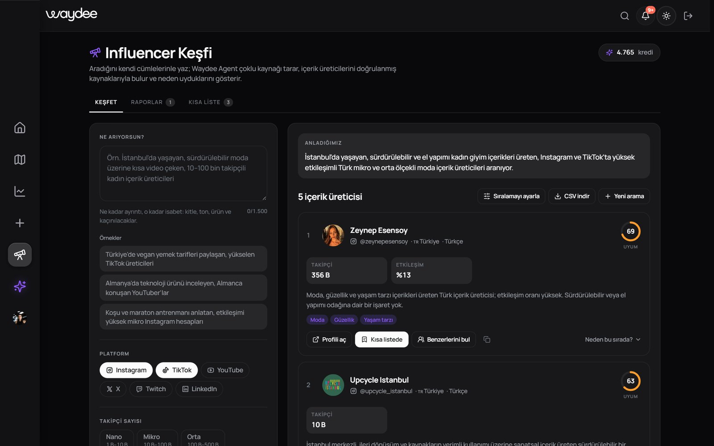

Marka ne aradığını kendi cümleleriyle yazar ve platform, takipçi aralığı, ülke, dil, bütçe gibi filtreleri seçer. Waydee Agent isteği bir arama planına çevirir ve çoklu kaynak taraması yapar. Ardından her adayı okunan bir kaynağa bağlar, kanıtsızları eler. Takipçi sayısı ve profil fotoğrafı, profil sayfasının kendisinden okunur. Sonuçlar sekiz sinyalli şeffaf bir formülle puanlanır; kullanıcı ağırlıkları radar grafiğinde değiştirdikçe sıralama anında güncellenir. Sonuçlar CSV olarak indirilebilir.

### 7. Detaylı veriler — performans
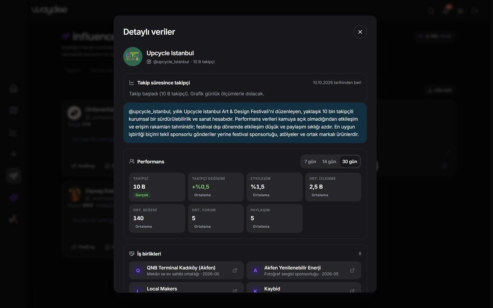

Kısa listeye alınan bir üretici için ikinci, daha derin bir araştırma yapılır. Ekranda son **7 / 14 / 30 günün** etkileşim oranı, ortalama izlenme, beğeni ve yorum, paylaşım sayısı ve takipçi değişimi gösterilir. Her sayının yanında kaynağı yazar:

- **Gerçek:** Bir kaynak sayfada açıkça yazan değer.
- **Ortalama:** Gerçek değer bulunamadığında platform ve takipçi seviyesinin ortalaması.
- **Takip:** Waydee'nin her gün kendisinin ölçtüğü değer.

Takipçi sayısı, kısa listede kaldığı sürece her gün ölçülür ve grafik bu ölçümlerle dolar.

### 8. Detaylı veriler — iş birlikleri ve kitle
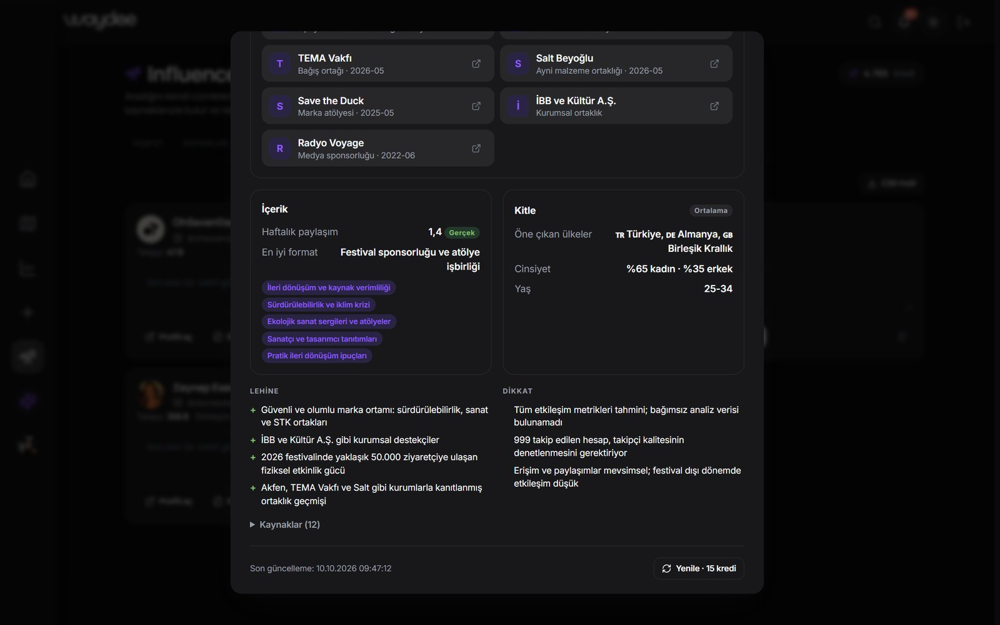

Üreticinin son 12 ayda çalıştığı markalar, iş birliği türü, tarih ve kaynak bağlantısıyla listelenir. Ayrıca kitle dağılımı (ülke, cinsiyet, yaş), içerik temaları, en iyi çalışan format, lehine ve dikkat edilecek noktalar ve doğrulanmış kaynak listesi yer alır.

### 9. Üyelik planları
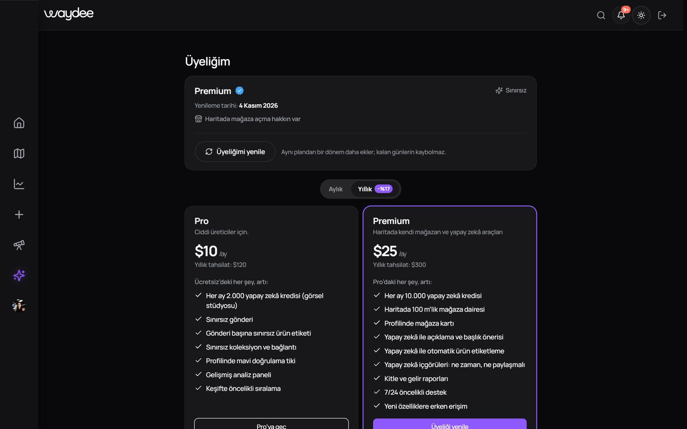

Ücretsiz, Pro ve Premium planlar aylık veya yıllık (%17 indirimli) faturalandırılır. Premium, haritada mağaza açma hakkı ve aylık 10.000 yapay zekâ kredisi içerir. Ödeme akışı [Polar](#-ödeme-altyapısı) üzerinden yürür.

---

## ✨ Özellikler

<details open>
<summary><b>Kullanıcı tarafı</b></summary>

- **Harita:** Mağaza açma (100 m sabit yarıçap), kategori filtresi, öne çıkarma sıralaması, gerçek zamanlı güncelleme, 3B pazar yeri görünümü (Three.js)
- **Sosyal:** Gönderi, hikâye, anket, etkinlik, yorum, beğeni, kaydetme, takip, koleksiyon, mesajlaşma, bildirim
- **Ticaret:** Ürün etiketleri, etiket gösterim/tıklama istatistikleri, link-in-bio sayfası, paylaşılabilir mağaza kartı (QR kodlu)
- **Analiz:** Profil ve gönderi istatistikleri, trafik kaynakları, haftalık rapor
- **Yapay zekâ:** AI Stüdyo, ürün etiketi önerisi, Waydee Agent (keşif, kısa liste, detaylı veriler)
- **Hesap:** E-posta doğrulama, Google ile giriş, şifre sıfırlama, kullanıcı adı değişimi, hesap silme (anonimleştirme)
- **Erişilebilirlik ve dil:** 5 dil, sağdan sola (RTL) düzen, açık/koyu tema, mobil uyumlu arayüz

</details>

<details>
<summary><b>Sunucu tarafı</b></summary>

- 17 iş modülü, 62 sürümlü veritabanı migration'ı (Flyway)
- Kredi defteri: her harcama ve iade tekil bir iş anahtarıyla kaydedilir, aynı işlem iki kez ücretlendirilemez
- Uzun süren yapay zekâ işleri için kuyruk, arka plan koşucusu ve takılan işi kapatıp krediyi iade eden zamanlanmış süpürücü
- Hız sınırlama (Redis), denetim kayıtları, yapılandırılmış JSON loglama, OpenAPI (Swagger) dokümanı
- SEO: sunucuda üretilen site haritası ve herkese açık profil sayfaları

</details>

---

## 🏛️ Mimari

Waydee bir **modüler monolit**tir: tek bir Spring Boot uygulaması, içeride iş alanlarına göre ayrılmış bağımsız modüller.

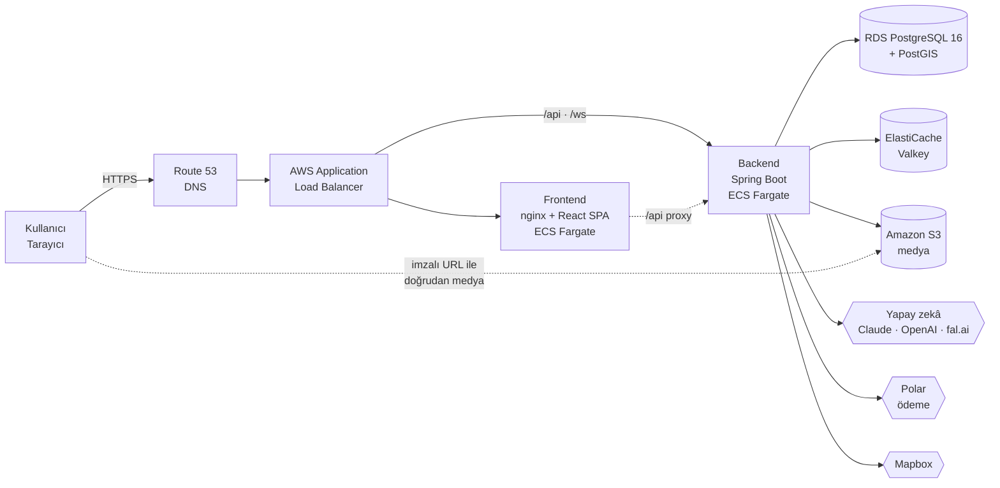

**Katmanlar (her modülde aynı):**

```
api/             Controller + istek/yanıt DTO'ları — entity asla dışarı açılmaz
application/     Servisler, iş kuralları, transaction sınırı
domain/          Entity, enum, değer nesneleri
infrastructure/  Repository'ler (Spring Data JPA)
```

**Neden modüler monolit?** Küçük bir ekip için mikroservis; ayrı dağıtım, ağ hataları, dağıtık transaction ve ayrı izleme yükü demektir. Modüller arası sınırlar kodda net çizildiği için, gerektiğinde bir modül (örneğin `creators` ya da `aistudio`) ayrı bir servise taşınabilir. Modüller birbirinin repository'sine erişmez; servis arayüzü ya da Spring olaylarıyla (`@TransactionalEventListener`) haberleşir.

---

## 🧰 Teknoloji Yığını

| Katman | Teknoloji | Neden |
|---|---|---|
| **Dil** | Java 21, TypeScript 6 | Güçlü tip sistemi; büyük iş mantığında güvenli yeniden düzenleme |
| **Backend** | Spring Boot 3.5, Spring Security, Spring Data JPA, WebSocket (STOMP) | Güvenlik, transaction ve zamanlanmış işler hazır ve olgun |
| **Veritabanı** | PostgreSQL 16 + PostGIS, Hibernate Spatial | Mağaza çakışması ve alan hesabı veritabanında, coğrafi indeksle |
| **Migration** | Flyway | Şema değişiklikleri sürümlü ve tekrar üretilebilir |
| **Önbellek** | Redis / Valkey | Hız sınırlama, harita önbelleği |
| **Depolama** | Amazon S3 (yerelde MinIO) | Aynı S3 API'si; kod değişmeden ortam değişir |
| **Frontend** | React 19, Vite 8, React Router 7 | Hızlı geliştirme ve derleme, geniş ekosistem |
| **Durum** | TanStack Query 5, Zustand 5 | Sunucu durumu ile arayüz durumu ayrı ve sade |
| **Stil** | Tailwind CSS 4, tasarım tokenları | Tutarlı tema, açık/koyu mod, RTL desteği |
| **Harita ve 3B** | Mapbox GL 3, Three.js, React Three Fiber | Vektör harita, yüksek performanslı 3B pazar yeri |
| **Animasyon** | Framer Motion, Lenis | Akıcı geçişler ve kaydırma |
| **Altyapı** | Docker, AWS ECS Fargate, GitHub Actions | Sunucu yönetimi olmadan ölçeklenen konteynerler |

---

## 🤖 Yapay Zekâ

Waydee model **eğitmez**. Hazır derin öğrenme modellerini API ile kullanır ve onları ürüne **güvenli, doğrulanabilir ve maliyeti kontrol edilen** şekilde bağlar. Asıl mühendislik katkısı bu entegrasyon ve doğrulama katmanıdır.

### Nerede, hangi model?

| Özellik | API ucu | Model / yöntem | Kategori |
|---|---|---|---|
| **AI Stüdyo — Manken, Editoryal, Poz** | `POST /api/v1/ai/fashion-model` · `/editorial` · `/pose` | fal.ai · `bytedance/seedream/v4/edit` | Generative AI (görüntü düzenleme) |
| **Görsel büyütme** (yüksek kalite modu) | AI Stüdyo içinde | fal.ai · `esrgan` | Computer Vision (süper çözünürlük) |
| **Ürün etiketi önerisi** | `POST /api/v1/media/tag-suggestions` | OpenAI uyumlu görsel-dil modeli (varsayılan `gpt-4o-mini`) + yedek olarak sunucu içi belirginlik (saliency) algoritması | Computer Vision · VLM |
| **Waydee Agent — Influencer Keşfi** | `POST /api/v1/creators/searches` | Anthropic Claude (web aramalı) · yedek: OpenAI Responses API | NLP · LLM · Agentic AI |
| **Waydee Agent — Detaylı Veriler** | `POST /api/v1/creators/shortlist/{id}/insights` | Claude / OpenAI | NLP · LLM · bilgi çıkarımı |

### Waydee Agent nasıl çalışır?

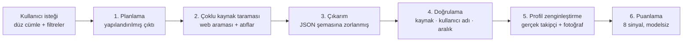

- **Uydurmaya karşı koruma:** Her aday, araştırmada gerçekten okunan bir sayfaya bağlanmak zorundadır; bağlanamayan aday elenir. Elenenler gerekçesiyle kullanıcıya gösterilir.
- **Gerçek veri önceliği:** Takipçi sayısı ve profil fotoğrafı yapay zekâya sorulmaz, profil sayfasının kendisinden okunur. Fotoğraf depomuza kopyalanır, platformun CDN'ine bağlantı verilmez.
- **Şeffaf puan:** Nihai sıralama yapay zekâ değil, sekiz sinyalin (kitle, içerik uyumu, coğrafya, dil, bütçe, etkileşim, erişim, ivme) ağırlıklı ortalamasıdır. Formül hem sunucuda hem istemcide aynıdır.
- **Sağlayıcı yedekleme:** Claude yanıt veremezse aynı adım OpenAI ile tekrarlanır. Sağlayıcı anahtarları yönetim panelinden girilir ve veritabanında **AES-256-GCM** ile şifreli saklanır.
- **Maliyet kontrolü:** Her iş kredi harcar, başarısızlıkta kredi otomatik iade edilir. Arama başına web araması sayısı sınırlıdır; aynı anda ve saatte açılabilecek iş sayısı kısıtlıdır.

---

## 💳 Ödeme Altyapısı

Ödemeler **[Polar](https://polar.sh)** üzerinden alınır. Polar *Merchant of Record* olarak çalışır: vergi (KDV/VAT), fatura ve uluslararası tahsilat yükünü üstlenir.

| Ürün | Model |
|---|---|
| **Pro** | Aylık abonelik ya da yıllık (aylık eşdeğeri indirimli) |
| **Premium** | Aylık abonelik ya da yıllık; harita mağazası + 10.000 AI kredisi/ay |
| **Mağazanı öne taşı** | Tek seferlik ödeme; kategori sıralamasında üst sıraya çıkma teklifi |
| **AI kredisi** | Plan dönemi başında yüklenir; harcama ve iadeler kredi defterine yazılır |

**Akış:**

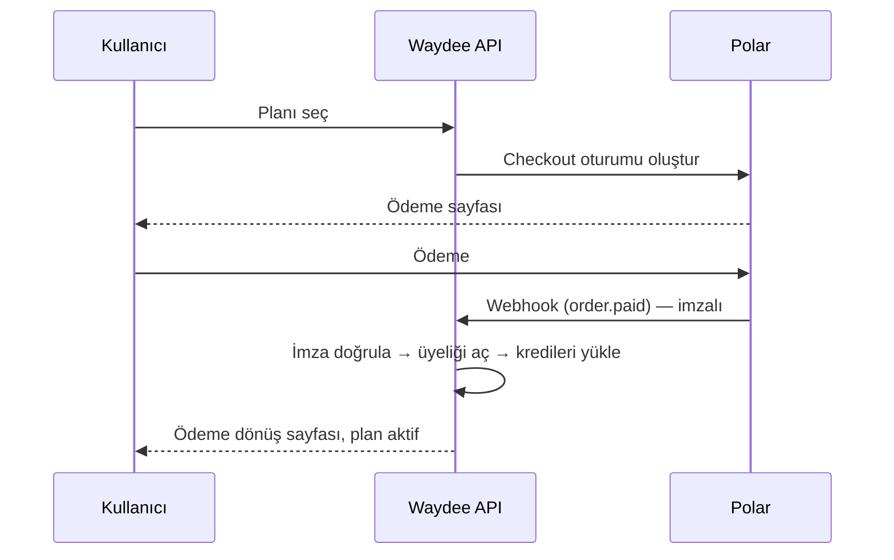

- **Webhook güvenliği:** Polar olayları *Standard Webhooks* imzasıyla doğrulanır; imzasız ya da süresi geçmiş istekler reddedilir.
- **Tekillik:** Aynı ödeme olayı iki kez gelirse ikinci kez üyelik ya da kredi verilmez; her yükleme tekil bir iş anahtarıyla kaydedilir.
- **Geliştirme ortamı:** `PAYMENT_PROVIDER=mock` ile gerçek tahsilat olmadan bütün akış denenir. Üretim profilinde sahte ödeme sağlayıcısıyla uygulama **açılmaz**.
- **Fatura:** Her ödeme için uygulama içinde fatura kaydı tutulur ve kullanıcı faturalarını görüntüleyebilir.

> Ödeme anahtarları ve ürün kimlikleri depoda tutulmaz; ortam değişkeni olarak AWS Secrets Manager'dan verilir.

---

## ☁️ AWS Altyapısı

Waydee üretimde AWS **eu-north-1 (Stockholm)** bölgesinde, tamamen yönetilen servislerle çalışır.

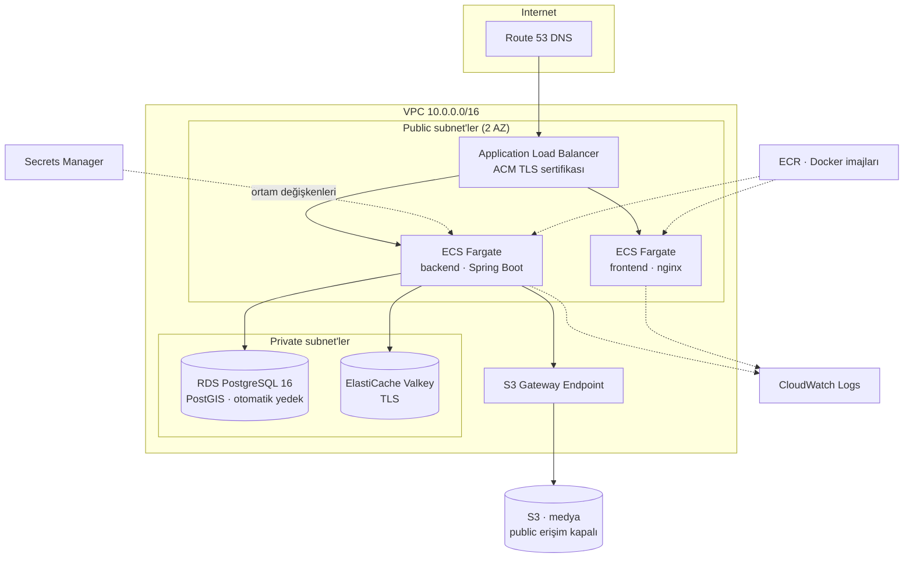

| Servis | Kullanım |
|---|---|
| **ECS Fargate** | Frontend ve backend konteynerleri; sunucu yönetimi yok, sağlık kontrolüyle otomatik yeniden başlatma |
| **Application Load Balancer** | HTTPS sonlandırma, `/api` ve `/ws` yönlendirmesi, WebSocket desteği |
| **Route 53** | DNS; kök alan adı ALB'ye Alias kaydıyla bağlı |
| **ACM** | `waydee.com` ve alt alan adları için TLS sertifikası |
| **RDS PostgreSQL 16** | PostGIS eklentili ana veritabanı; özel subnet, 7 günlük otomatik yedek, otomatik büyüyen gp3 disk |
| **ElastiCache (Valkey)** | Önbellek ve hız sınırlama; aktarımda şifreleme açık |
| **S3** | Medya deposu; tüm public erişim kapalı, kullanıcıya kısa ömürlü **imzalı URL** ile sunulur |
| **Secrets Manager** | Veritabanı, JWT, ödeme ve e-posta sırları; konteynere görev tanımıyla enjekte edilir |
| **ECR** | Sürüm etiketli Docker imajları (`latest` + commit SHA) |
| **CloudWatch Logs** | Yapılandırılmış JSON loglar, 30 gün saklama |
| **IAM + OIDC** | GitHub Actions, AWS'ye **kısa ömürlü jetonla** bağlanır; depoda hiçbir AWS erişim anahtarı yoktur |

**Bilinçli maliyet kararları:** NAT Gateway kullanılmaz. Fargate görevleri public subnet'te çalışır, gelen trafik yalnız load balancer'ın güvenlik grubundan kabul edilir. S3 erişimi ücretsiz VPC Gateway Endpoint üzerinden yapılır. Güvenlik grupları katmanlıdır: `internet → ALB → uygulama → veritabanı / önbellek`.

### CI/CD

| İş akışı | Tetikleyici | Ne yapar |
|---|---|---|
| [`ci.yml`](.github/workflows/ci.yml) | Her push ve pull request | Backend birim testleri + frontend tip kontrolü ve derleme |
| [`deploy-backend.yml`](.github/workflows/deploy-backend.yml) | Elle (`workflow_dispatch`) | Docker imajı → ECR → ECS yeniden dağıtım |
| [`deploy-frontend.yml`](.github/workflows/deploy-frontend.yml) | Elle (`workflow_dispatch`) | Vite derlemesi + nginx imajı → ECR → ECS |

Gerekli GitHub sırları: `AWS_ROLE_ARN`, `VITE_MAPBOX_TOKEN`, `VITE_TURNSTILE_SITE_KEY`.

---

## 🔐 Güvenlik

- **Kimlik doğrulama:** JWT erişim jetonu + dönen (rotating) yenileme jetonu; Google OAuth 2.0
- **Yetkilendirme:** Rol tabanlı (`USER`, `ADMIN`); her kayıt sahiplik koşuluyla okunur, kimliği tahmin edilen başkasının kaydı açılamaz
- **Bot koruması:** Giriş ve kayıtta Cloudflare Turnstile
- **Hız sınırlama:** Redis tabanlı; giriş uçlarında daha sıkı sınırlar
- **Sır yönetimi:** Hiçbir anahtar kaynak kodda yoktur. AI sağlayıcı anahtarları veritabanında AES-256-GCM ile şifreli saklanır, arayüzde yalnız maskeli hâli görünür
- **Üretim koruması:** `prod` profilinde geliştirme şifresi, zayıf JWT anahtarı, açık Swagger veya sahte ödeme sağlayıcısı tespit edilirse uygulama açılmaz (`ProductionSecretsGuard`)
- **Ters vekil güvenliği:** İstemci IP'si `X-Forwarded-For` zincirinin güvenilen ucundan okunur; sahte başlıkla hız sınırı aşılamaz
- **Medya:** S3 kovası tamamen özel, erişim süreli imzalı URL ile
- **Gizlilik:** Hesap silme, ilişkili kayıtları bozmadan kişisel veriyi anonimleştirir

---

## 📈 Ölçeklenebilirlik

**Yatay:** Uygulama durumsuz (stateless) tasarlanmıştır:

- Oturum JWT'de tutulur, sunucu belleğinde oturum yoktur.
- Paylaşılan durum Redis'te, dosyalar S3'te durur.
- Medya kullanıcıya backend'den akmaz, imzalı URL ile doğrudan S3'ten gider.
- Zamanlanmış işler birden çok kopyada güvenle çalışır: veritabanındaki tekil indeksler aynı işin iki kez yapılmasını engeller.

Bu sayede ECS görev sayısı artırıldığında yük, load balancer arkasında yeni kopyalara dağılır.

**Dikey:** Fargate görevinin CPU ve belleği, RDS ve ElastiCache sınıfı tek ayarla büyütülür; RDS diski otomatik büyür.

**Asenkron işler:** Yapay zekâ üretimleri ve araştırmaları HTTP isteğini bekletmez. Ayrı bir thread havuzunda koşar; istemci ilerlemeyi adım adım izler.

---

## 📁 Proje Yapısı

```
.
├── .github/workflows/        CI ve AWS dağıtım iş akışları
├── backend/                  Spring Boot uygulaması
│   ├── src/main/java/com/waydee/
│   │   ├── identity/         Kayıt, giriş, JWT, Google OAuth, plan ve kredi
│   │   ├── territory/        Haritada mağaza açma, çakışma kontrolü
│   │   ├── geo/              Ülke/il/ilçe, PostGIS, bölge fiyatlandırma
│   │   ├── social/           Gönderi, hikâye, yorum, medya, ürün etiketleri, etiket önerisi
│   │   ├── marketplace/      Pazar yerleri, mağaza kategorileri
│   │   ├── messaging/        Mesajlaşma
│   │   ├── realtime/         WebSocket (STOMP) yayınları
│   │   ├── payment/          Polar ödeme ve webhook'lar
│   │   ├── billing/          Fatura ve kupon
│   │   ├── monetization/     Plan fiyatları ve kazanç
│   │   ├── promotion/        "Mağazanı öne taşı" teklifleri
│   │   ├── aistudio/         AI Stüdyo (fal.ai)
│   │   ├── creators/         Waydee Agent: keşif, kısa liste, detaylı veriler
│   │   ├── moderation/       Şikâyet ve kısıtlamalar
│   │   ├── traffic/          Ziyaret ve tıklama analitiği
│   │   ├── publicview/       Herkese açık sayfalar, SEO, site haritası
│   │   ├── admin/ outreach/  Yönetim uçları ve toplu e-posta
│   │   └── common/           Güvenlik, şifreleme, depolama, loglama, ortak ayarlar
│   ├── src/main/resources/
│   │   ├── application.yml
│   │   └── db/migration/     Flyway migration'ları (V1 … V62)
│   ├── src/test/             Birim testleri
│   └── Dockerfile
├── frontend/                 React uygulaması
│   ├── src/
│   │   ├── app/              Router, korumalar, gezinme
│   │   ├── features/         Özellik klasörleri (map, store, post, ai, creators, plan…)
│   │   ├── components/       Ortak arayüz bileşenleri
│   │   ├── lib/              API istemcileri ve yardımcılar
│   │   ├── stores/           Zustand durumları (oturum, tema, dil)
│   │   └── i18n/             5 dil sözlüğü
│   ├── public/               Fontlar, ikonlar, görseller
│   ├── nginx.conf            Üretim sunucusu ve /api vekili
│   └── Dockerfile
├── docs/screenshots/         README görselleri
├── docker-compose.yml        Yerel PostgreSQL+PostGIS, Redis, MinIO
└── .env.example              Yerel altyapı değişkenleri
```

---

## 🚀 Yerel Kurulum

**Gereksinimler:** Docker, JDK 21, Node.js 22, pnpm 10

```bash
# 1) Altyapı: PostgreSQL + PostGIS, Redis, MinIO
cp .env.example .env
docker compose up -d

# 2) Backend → http://localhost:8091  (Swagger: /swagger-ui.html)
cd backend
cp .env.example .env           # gerekirse değerleri doldurun
./mvnw spring-boot:run

# 3) Frontend → http://localhost:5175
cd ../frontend
cp .env.example .env
pnpm install
pnpm dev
```

- Veritabanı şeması ilk açılışta Flyway ile kurulur. Coğrafi veri (ülkeler, Türkiye'nin 81 ili ve ilçeleri) migration'larla gelir.
- İlk yönetici hesabı için `ADMIN_INITIAL_PASSWORD` ortam değişkenini verin.
- Ödeme yerelde `mock` sağlayıcıyla çalışır; gerçek tahsilat yapılmaz.
- Yapay zekâ özellikleri için ilgili anahtarlar gerekir (`FAL_API_KEY`, `VISION_API_KEY`). Waydee Agent anahtarları yönetim panelinden girilir.

**Testler:**

```bash
cd backend && ./mvnw verify      # birim testleri
cd frontend && pnpm build        # tip kontrolü + derleme
```

---

## 📜 Açık Kaynak Lisansları

Waydee'nin altyapısı ağırlıklı olarak açık kaynak yazılımlar üzerine kuruludur:

| Bileşen | Lisans |
|---|---|
| Spring Boot, Spring Security, Spring Data, Hibernate | Apache 2.0 / LGPL 2.1 (Hibernate) |
| Flyway (Community) | Apache 2.0 |
| PostgreSQL | PostgreSQL License |
| PostGIS | GPL 2.0 |
| Redis 7 / Valkey | BSD 3-Clause |
| MinIO (yalnız yerel geliştirme) | AGPL 3.0 |
| JJWT, springdoc-openapi, MinIO Java SDK, Anthropic Java SDK | Apache 2.0 |
| TwelveMonkeys ImageIO (WebP) | BSD 3-Clause |
| Lombok | MIT |
| React, React Router, TanStack Query, Zustand | MIT |
| Vite, Tailwind CSS, TypeScript | MIT / Apache 2.0 (TypeScript) |
| Three.js, React Three Fiber, Drei | MIT |
| Framer Motion, Lenis, Axios, STOMP.js | MIT / Apache 2.0 (STOMP.js) |
| Lucide, Phosphor Icons | ISC / MIT |
| Manrope, Playfair Display yazı tipleri | SIL Open Font License 1.1 |

**Ticari servisler:** Mapbox (harita), Amazon Web Services, Polar (ödeme), fal.ai, Anthropic, OpenAI, Cloudflare Turnstile (bot koruması).
**Görseller:** Demo ve karşılama sayfası fotoğrafları [Unsplash Lisansı](https://unsplash.com/license) ile kullanılmıştır.

> Waydee'nin kendi kaynak kodu için tüm hakları saklıdır.

---

## 🗺️ Yol Haritası

- [ ] AI Stüdyo'da video üretimi ve ek düzenleme araçları
- [ ] CloudFront CDN ile medya ve statik dosya dağıtımı
- [ ] Backend'in birden çok kopyayla yük testi ve otomatik ölçekleme kuralları
- [ ] Harita uçlarında görünür alana göre filtreleme ve geometri sadeleştirme
- [ ] Frontend için otomatik test altyapısı
- [ ] Yapay zekâ maliyet optimizasyonu: hafif adımlarda küçük model

---

## 👥 Ekip

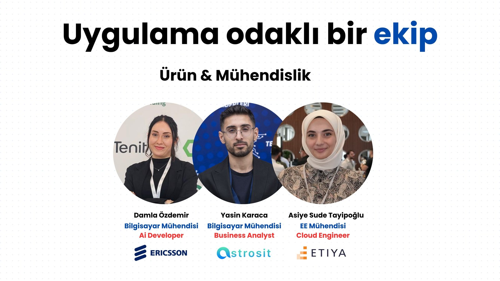

| İsim | Rol | Uzmanlık |
|---|---|---|
| **Damla Özdemir** | AI Developer | Bilgisayar Mühendisi |
| **Yasin Karaca** | Business Analyst | Bilgisayar Mühendisi |
| **Asiye Sude Tayipoğlu** | Cloud Engineer | Elektrik-Elektronik Mühendisi |
